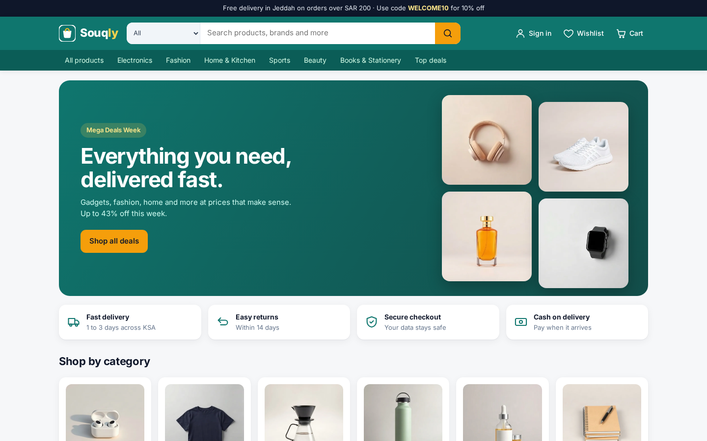
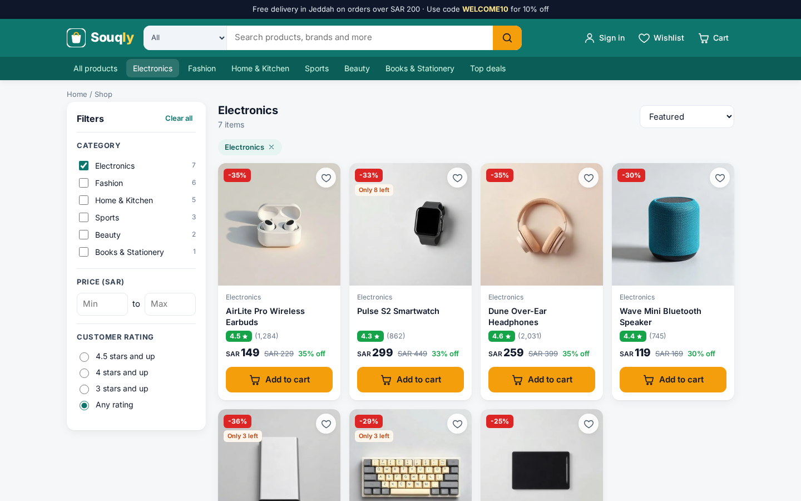
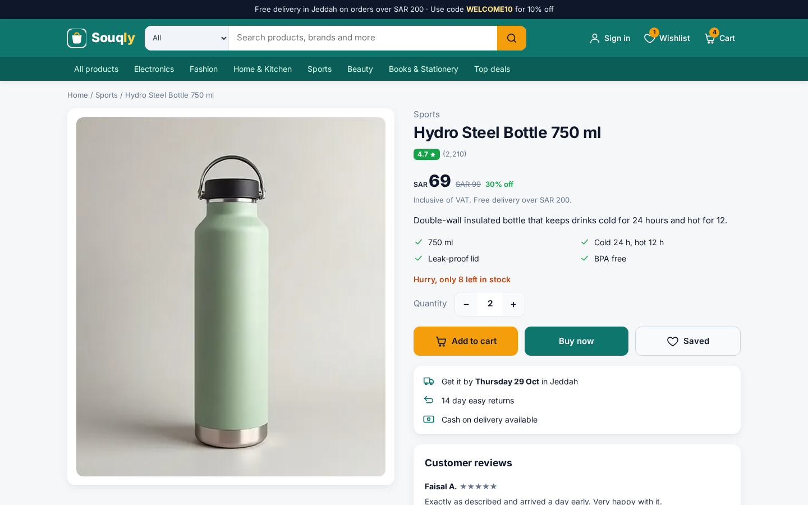
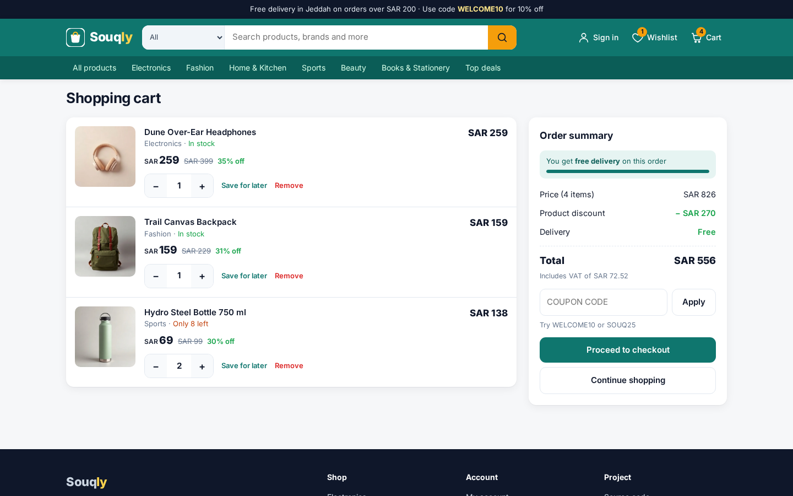
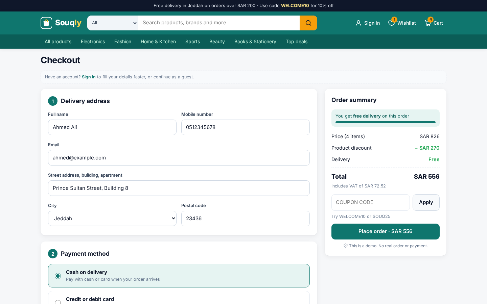
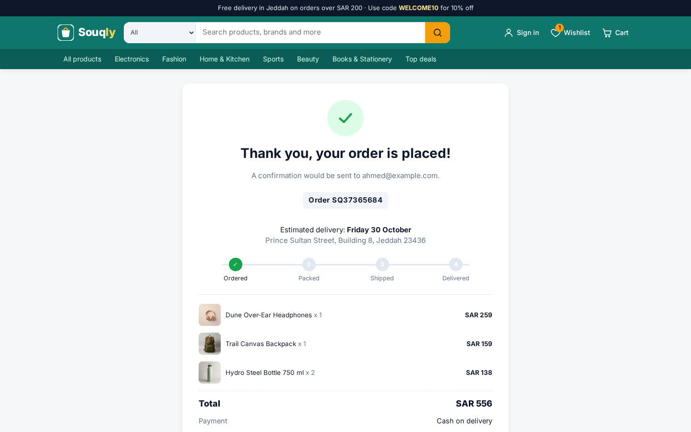
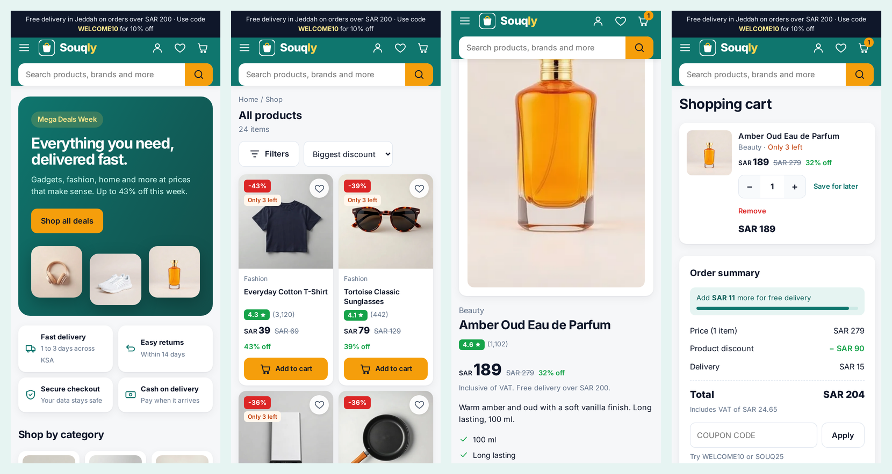

# Souqly: online shop front end

A responsive e-commerce website inspired by big online stores. You can browse products, search and filter, open a product page, add items to the cart or wishlist, apply a coupon, check out and get an order confirmation. There is also a simple account area with sign up, sign in, profile and order history.

It runs fully in the browser with HTML, CSS and vanilla JavaScript. Cart, wishlist, accounts and orders are saved in `localStorage`, so there is no backend and no real payment.

**Live demo:** https://mohammadgulab.github.io/souqly-shop/



## Features

- **Home page** with a deals banner, category tiles, best deals and top rated sections
- **Search** with live suggestions (keyboard friendly) and a category selector
- **Product listing** with filters for category, price range and rating, sorting (price, rating, discount, popularity) and removable filter chips
- **Product page** with image zoom, highlights, stock status, quantity selector, delivery date, reviews and related products
- **Cart** with quantity controls, remove, save for later, free delivery progress bar, VAT breakdown and coupon codes (`WELCOME10`, `SOUQ25`)
- **Buy now** that skips the cart and goes straight to checkout
- **Checkout** with address form validation (Saudi mobile number, 5 digit postal code), cash on delivery or card (Luhn check, test number only)
- **Order confirmation** with an order number, delivery estimate and a progress tracker
- **Account** with sign up and sign in, editable profile and order history
- **Wishlist** with move to cart
- Works on phone, tablet and desktop, with a slide-in menu and a bottom filter sheet on mobile

## Screenshots

| Product listing | Product page |
| --- | --- |
|  |  |

| Cart | Checkout |
| --- | --- |
|  |  |

**Order confirmation**



**On mobile**



## Tech

- HTML5, CSS3 (Grid, Flexbox, custom properties, media queries)
- Vanilla JavaScript (ES6+), hash based routing, no framework and no build step
- `localStorage` for cart, wishlist, users and orders
- Web Crypto (SHA-256) so demo passwords are not stored as plain text
- Hosted on GitHub Pages

## Project structure

```
index.html      page shell: header, search, menu, footer
styles.css      all styles and responsive breakpoints
app.js          router, views, cart, wishlist, checkout and account logic
data.js         product catalogue (24 products, prices in SAR)
img/            product images
screenshots/    images used in this README
```

## Run it locally

No install needed. Clone the repo and open `index.html`, or serve the folder:

```
git clone https://github.com/mohammadgulab/souqly-shop.git
cd souqly-shop
python -m http.server 8000
```

Then open http://localhost:8000.

## Notes

Souqly is a portfolio project, not a real store. The brand, products and reviews are made up and the product photos are generic images with no real brands. No order is placed and no payment is taken.

## Author

**Mohammad Gulab**, Jeddah, Saudi Arabia

- Portfolio: https://mohammadgulab.github.io/
- GitHub: [@mohammadgulab](https://github.com/mohammadgulab)
